# Transformer Architecture — Interview & AI Architect Notes

> **Learning path:** Intuition → Internal components → Encoder/decoder families → Inference → Enterprise architecture decisions.
>
> Mermaid diagrams render in GitHub Markdown and other Mermaid-enabled viewers.

## 1. What is a Transformer?

A **Transformer** is a neural-network architecture for sequences. It uses **attention** to combine information across tokens, letting it learn relationships even when relevant words are far apart. The original design was introduced in *Attention Is All You Need* (2017).

**Analogy:** An RNN is an analyst reading an incident log sequentially while maintaining a running mental summary. A Transformer lets an analyst examine relevant lines of the incident log together when assessing each line.

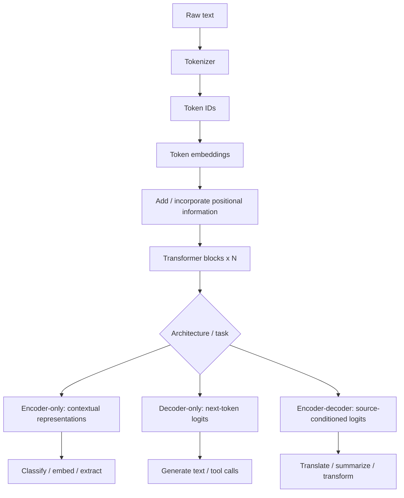

## 2. Transformer processing stages

| Stage | What happens | Analogy | Architect concern |
|---|---|---|---|
| Tokenization | Split text into vocabulary tokens; map to IDs | Compiler lexical analysis | Token cost, logs/code token efficiency |
| Token embeddings | Look up learned vectors for token IDs | Numeric profile for each token | Model's representation dimension |
| Positional information | Convey token order (e.g., sinusoidal encodings or RoPE) | Order of steps in a runbook | Long-context performance |
| Attention | Mix information across allowed sequence positions | Consult relevant colleagues | Compute and memory growth |
| Multi-head attention | Parallel attention with distinct learned projections | Several investigation perspectives | Head count vs KV-head sharing |
| Feed-forward network | Nonlinearly transform each token representation | Privately process gathered evidence | Parameters and inference cost |
| Residual + normalization | Preserve information paths and stabilize deep computation | Keep original notes while refining analysis | Stable deep model execution |
| Output head | Convert representations to class scores or vocabulary logits | Final classification or report | Output reliability and decoding |

### Example input

`The server crashed because it ran out of memory.`

A tokenizer produces **token IDs** (exact split varies by tokenizer). The embedding layer maps them into vectors. Positional information differentiates sequences with the same words but different order.

## 3. Self-attention: Q, K, V

Each token representation is projected into:

- **Query (Q):** What information am I looking for?
- **Key (K):** What information can I match against?
- **Value (V):** What information do I contribute?

The core operation is:

$$
\operatorname{Attention}(Q,K,V)=\operatorname{softmax}\left(\frac{QK^T}{\sqrt{d_k}}+M\right)V
$$

Here `M` is an optional attention mask, e.g., a causal mask, with disallowed positions assigned a very negative score (conceptually negative infinity).

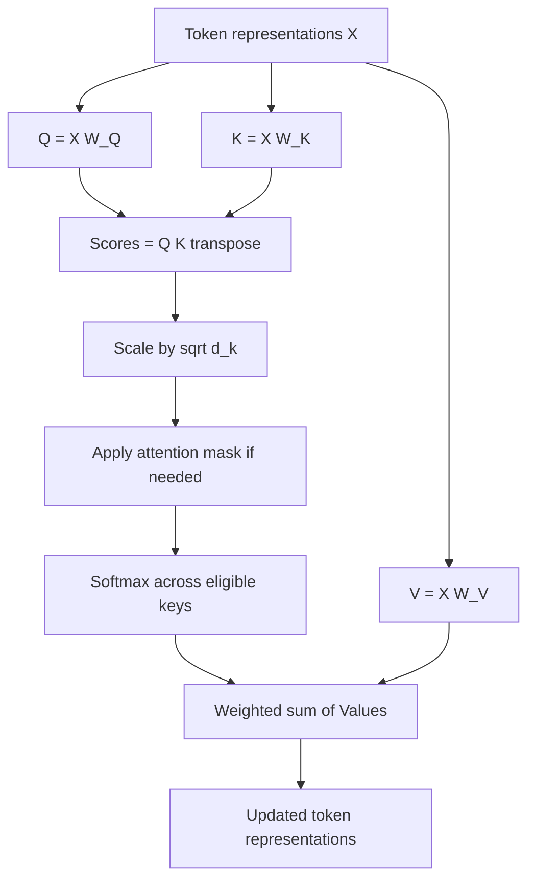

### Worked intuition

For the token **“it”** in “The database server crashed because it ran out of memory,” some attention heads might assign relatively high weight to **“database”** and **“server”**, depending on context. The learned attention weights differ by head and layer; they are **not** guaranteed to be human-readable explanations.

### What is softmax?

It maps any vector of scores to nonnegative weights that sum to one:

$$
\operatorname{softmax}(z_i)=\frac{e^{z_i}}{\sum_j e^{z_j}}
$$

Example: scores `[2, 1, 0]` produce approximately `[0.665, 0.245, 0.090]`.

**Two distinct uses of softmax:**

1. **Inside attention:** convert Q–K similarity scores into weights over value vectors.
2. **At token output:** convert vocabulary logits into a next-token probability distribution (sometimes adjusted by temperature or other sampling methods).

## 4. Multi-head attention

A single attention head operates in one learned projected space. Multiple heads provide different representation subspaces and can learn different relationships.

**Analogy:** During an outage, one engineer focuses on network symptoms, another on storage, and another on application history. The organization combines the findings. Attention heads are *not* explicitly assigned these roles; they learn from training.

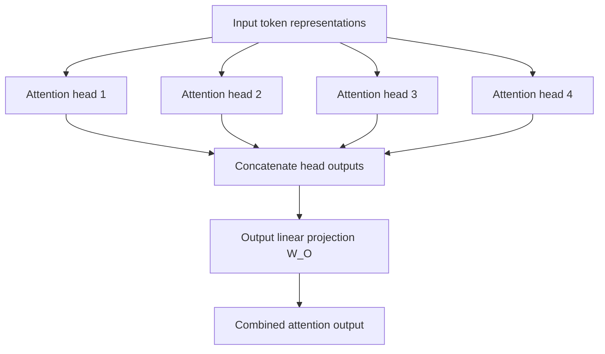

$$
\operatorname{MultiHead}(Q,K,V)=\operatorname{Concat}(head_1,\ldots,head_h)W^O
$$

For a hypothetical model with `d_model = 768` and `12` equally sized heads, each head can operate on a `64`-dimensional Q/K space.

**Architecture note:** MQA and GQA use fewer key/value heads than query heads and can substantially reduce KV-cache size and memory bandwidth during inference.

## 5. Feed-forward network (FFN), residuals, normalization

Attention exchanges information **between token positions**. A position-wise FFN transforms **each token's representation** with learned nonlinear functions.

Original Transformer formulation:

$$
\operatorname{FFN}(x)=\max(0,xW_1+b_1)W_2+b_2
$$

Modern models may use GELU or SwiGLU. Residual connections and normalization support deep stacks. Their ordering differs among model architectures.

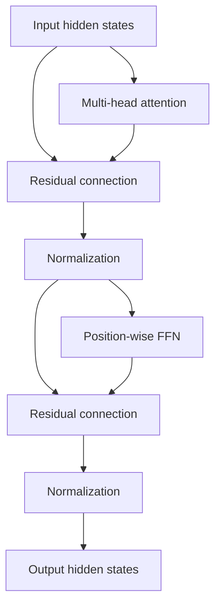

> The above illustrates a **post-norm conceptual block**; many production Transformers use **pre-norm** variants.

## 6. Encoder-only Transformer

**Core idea:** Make rich contextual representations of the input using **bidirectional self-attention**. Common uses: classification, entity extraction, semantic representations, and reranking.

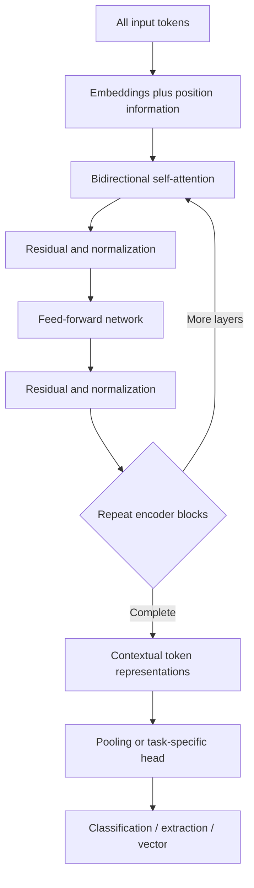

**Analogy:** Read an incident ticket *in full* before deciding its severity. Tokens are allowed to inspect both earlier and later input positions.

**Examples:** BERT, RoBERTa, DistilBERT, ModernBERT, Sentence-BERT-style embedding systems.

**Use when:** fixed-label classification, named-entity recognition, efficient document representation, or similarity search with a model trained for embedding. Standard BERT is not automatically an optimal sentence embedding model without suitable training/pooling.

## 7. Decoder-only Transformer

**Core idea:** Generate tokens **autoregressively**. Causal masking prevents a position from attending to future tokens.

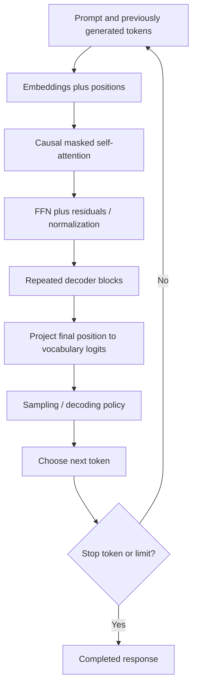

### Causal attention mask

`✓` = visible, `×` = future token hidden. Rows are query positions; columns are key positions.

| Query \\ Key | The | server | is | down |
|---|---|---|---|---|
| The | ✓ | × | × | × |
| server | ✓ | ✓ | × | × |
| is | ✓ | ✓ | ✓ | × |
| down | ✓ | ✓ | ✓ | ✓ |

**Analogy:** A technical writer composes a runbook one token at a time, using what has already been written, without seeing unwritten future tokens.

**Examples:** GPT-family, Llama, Gemma, Qwen.

**Use when:** general assistants, coding, natural-language generation, explanation, reasoning-oriented tasks, and agent tool-calling workflows.

> Decoder-only refers to the **model architecture**. It does not mean the wider system cannot perform retrieval or classification.

## 8. Encoder–decoder Transformer

**Core idea:** Encode a source input, then autoregressively generate the target conditioned on that source. A decoder uses **masked self-attention** over prior generated output plus **cross-attention** to encoded source states.

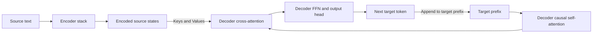

Cross-attention for a standard encoder–decoder model:

- **Q** comes from decoder hidden states.
- **K and V** come from encoder output states.

**Analogy:** A translator understands the full source document and writes the translation while continuously referring back to the source.

**Examples:** T5 / FLAN-T5, BART, mT5, MarianMT.

**Use when:** translation, constrained source-to-target transformations, and certain summarization workloads. A decoder-only LLM can also perform these tasks; benchmark before choosing.

## 9. Compare the three architectures

| Decision | Encoder-only | Decoder-only | Encoder–decoder |
|---|---|---|---|
| Attention | Bidirectional input attention | Causal self-attention | Bidirectional source + causal target + cross-attention |
| Typical output | Classes, features, vectors | New token sequence | New source-conditioned sequence |
| Typical strength | Understanding and representation | Flexible generation | Structured source-to-target generation |
| Classification | Natural fit | Possible | Possible |
| Chatbot | Not natural by itself | Natural fit | Possible |
| Translation | Not natural by itself | Good with appropriate model | Natural fit |
| Semantic retrieval | Use dedicated embedding encoder | Specially trained variants possible | Usually not first choice |
| Example models | BERT, RoBERTa | GPT, Llama | T5, BART |

## 10. Which architecture should an AI architect select?

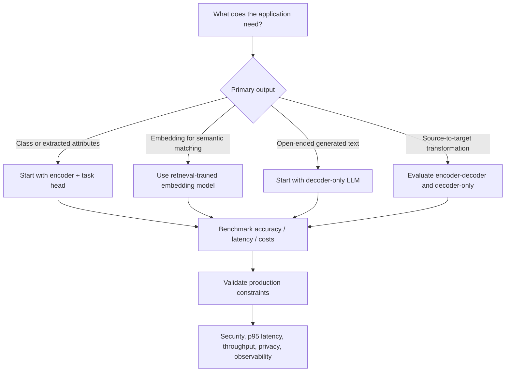

| Use case | Starting architecture | Rationale |
|---|---|---|
| Incident severity / category | Encoder-only classifier | Compact, supervised labels, low latency |
| Search across technical docs | Retrieval-trained embedding model + optional reranker | Efficient similarity and relevance |
| Chat-based SRE assistant | Decoder-only LLM | Flexible question answering and tool interactions |
| Translation service | Encoder–decoder or specialized multilingual LLM | Conditional sequence transformation |
| Long document summarization | Benchmark encoder–decoder vs decoder-only | Output quality and context limits dominate |
| Enterprise RAG | Embedding model + reranker + decoder-only LLM | Separate retrieval from synthesis |
| Multi-agent system | Decoder-only LLM(s) + deterministic orchestrator | Planning/tool-use needs external execution controls |

### Architecture rule of thumb

Do not pick a model family based only on labels. **Measure end-to-end task quality, p95 latency, throughput, memory, price, security, and operations** using representative workload data.

## 11. Practical enterprise example: z/OS health assistant

Imagine an agent that responds to “Analyze JES2 spool health, correlate the findings with product documentation, and provide evidence.”

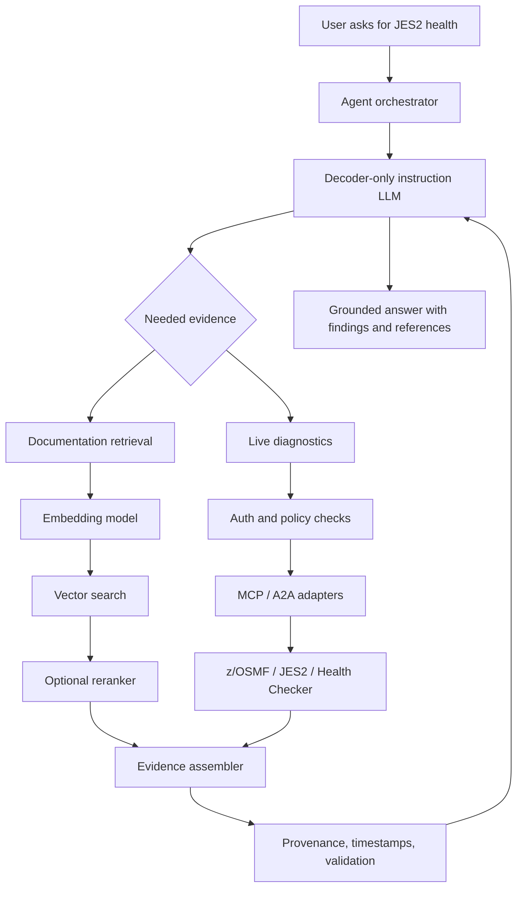

**Division of responsibility:**

- **Encoder-style embedding model:** find relevant documentation.
- **Reranker:** prioritize evidence relevant to the query.
- **Decoder-only LLM:** interpret intent, decide tool calls, synthesize an answer.
- **Orchestration software:** maintain task state, retries, timeouts, and execution boundaries.
- **Tool adapters:** make authorized system calls and return evidence.
- **Policy/evidence services:** enforce access control and preserve provenance.

**Important:** An LLM's textual decision is *not* an authorization policy. Validate tool inputs and permissions outside the model. Do not rely on the model to independently verify its own conclusions.

## 12. Inference: prefill, decode, KV cache

For autoregressive decoder inference:

1. **Prefill:** Process the entire prompt with causal attention and populate the per-layer KV cache.
2. **Decode:** Generate next tokens step by step, reusing previously cached K/V instead of recomputing all prior positions.
3. **Stop:** End at an EOS token, stop sequence, or configured limit.

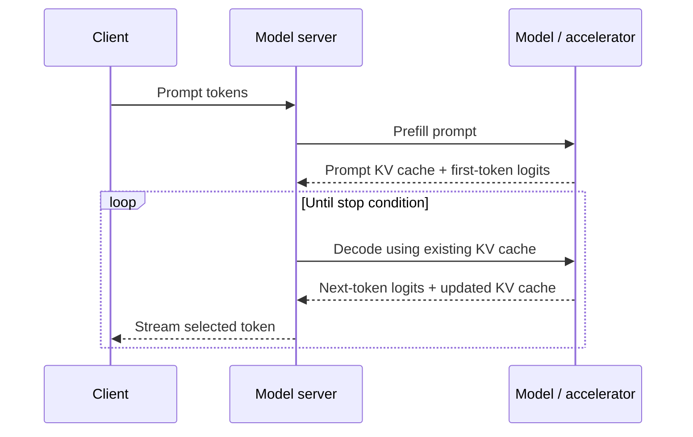

### Why KV-cache memory matters

For fixed KV dimensions and datatype, an approximate cache size is:

$$
M_{KV}=2 \times L \times H_{kv} \times D_h \times T \times B \times S
$$

Where:

- `L`: layer count
- `H_kv`: number of key/value heads
- `D_h`: per-head K/V dimension
- `T`: cached tokens per sequence
- `B`: bytes per cache element
- `S`: active sequences of the same length (otherwise sum token lengths over sequences)

**Illustrative example:** 32 layers × 8 KV heads × 128 dimensions × 8192 tokens × 2 bytes × 10 active sequences × 2 for keys and values ≈ **10 GiB** of KV cache. This excludes weights and runtime overhead.

| Serving concept | Architect significance |
|---|---|
| TTFT | Time-to-first-token; prompt processing and queueing dominate many requests |
| Inter-token latency | Responsiveness while output streams |
| Tokens/sec | Generation throughput and cost |
| Batch scheduling | Trades utilization against latency |
| GQA / MQA | Reduce stored K/V heads |
| Quantization | Reduce weight and/or cache precision, with accuracy trade-offs |
| FlashAttention | Optimized memory-efficient attention computation |
| Context length | Affects cache size, memory demand, and quality |
| MoE routing | Activates a subset of expert networks; changes memory/compute trade-offs |

## 13. Interview-ready answers

**Q: Why is a Transformer generally more parallelizable than an RNN?**  
A: It does not require the recurrent hidden-state update between sequence positions during training. Self-attention can process interactions among input positions using parallel matrix operations.

**Q: What is self-attention?**  
A: For each query token, compare a query vector against keys, normalize the scores, and use them as weights to combine values from eligible tokens.

**Q: Why divide attention scores by `sqrt(d_k)`?**  
A: To control dot-product magnitude as key/query dimension increases, reducing softmax saturation and helping stable optimization.

**Q: Self-attention vs cross-attention?**  
A: Self-attention obtains Q, K, and V from the same sequence; cross-attention draws Q from one sequence (e.g., decoder) and K/V from another (e.g., encoder).

**Q: Why multi-head attention?**  
A: Different projections can learn complementary token relationships or feature subspaces. Heads are not guaranteed to correspond to human-defined linguistic roles.

**Q: Why is masked attention required in a decoder?**  
A: To prevent tokens from seeing future target tokens during autoregressive prediction.

**Q: Is softmax used only once?**  
A: No. It normalizes attention scores and can separately normalize vocabulary logits during token selection.

**Q: What is a KV cache?**  
A: Saved attention key/value tensors for previous positions, reused during token-by-token generation to reduce repeated work.

**Q: Encoder vs decoder for classification?**  
A: A fine-tuned encoder is often a sensible efficient starting point, but a decoder-only model can also classify effectively. Benchmark using representative data and service constraints.

**Q: How do Transformers affect agent architecture?**  
A: They provide the reasoning/generation engine; production agent systems additionally require deterministic orchestration, permissions, tool contracts, state, tracing, and evaluation.

## 14. One-page revision

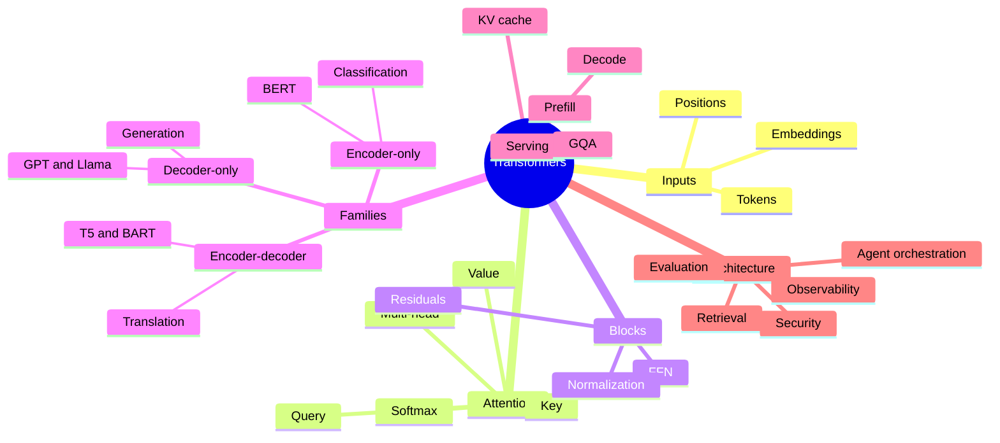

### References

- Vaswani et al., [Attention Is All You Need](https://arxiv.org/abs/1706.03762) (2017)
- [The Illustrated Transformer — Jay Alammar](https://jalammar.github.io/illustrated-transformer/)
- [Hugging Face — Transformer model families](https://huggingface.co/learn/llm-course/chapter1/6)

---

**Architect takeaway:** Choose encoder-style models for representation, decoder-only models for flexible generation, and encoder–decoder models for source-conditioned transformation when they meet the requirements best. In enterprise systems, combine those models with retrieval, runtime controls, evaluation, security, and observability rather than expecting a single model to do everything.
